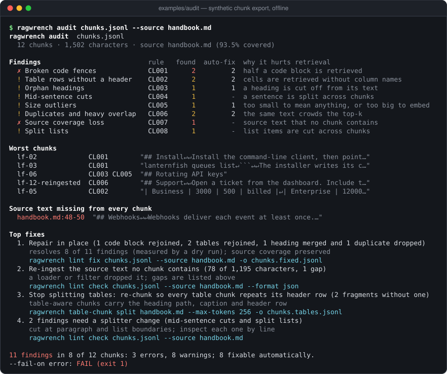

<p align="center">
  <picture>
    <source media="(prefers-color-scheme: dark)" srcset="assets/logo-dark.svg">
    
  </picture>
</p>

<p align="center">
  <strong>Find the chunks that silently break your RAG answers, then fix them.</strong><br>
  One offline CLI for chunk QA, vector-store plumbing, citations and retrieval evals.
</p>

<p align="center">
  <a href="https://github.com/tianhaogutum/ragwrench/actions/workflows/ci.yml"></a>
  <a href="https://pypi.org/project/ragwrench/"></a>
  <a href="https://pypi.org/project/ragwrench/"></a>
  <a href="LICENSE"></a>
</p>

<p align="center">
  English · <a href="README.zh-CN.md">简体中文</a>
</p>

<p align="center">
  <strong>Cut a table at a fixed token count and BM25 retrieves the right cell for 15% of lookups. Repeat the header row in every chunk: 100%.</strong><br>
  <sub>720 cell lookups over four synthetic 60-row tables, same 120-token budget, hit@3 0.154 vs 1.000. <a href="benchmarks/table-chunk/results.json">Stored result</a> · <a href="docs/table-chunk.md#reproduce-the-retrieval-experiment">method</a> · reproduce with <code>ragwrench table-chunk bench</code>.</sub>
</p>

```sh
uvx ragwrench audit chunks.jsonl --source handbook.md   # or: pipx install ragwrench  /  pip install ragwrench
```

<p align="center">
  
</p>
<p align="center"><sub>Real output on the bundled synthetic export (<code>examples/audit</code>, fictional content, no network). Regenerate with <code>assets/render_terminal.py</code>.</sub></p>

## Quick start

`audit` reads a chunk export (JSONL or a JSON array: LangChain `page_content`, LlamaIndex nodes, or plain `{"id", "text"}`) and never writes anything:

```sh
uvx ragwrench audit chunks.jsonl                        # structure only
uvx ragwrench audit chunks.jsonl --source handbook.md   # also: is every source sentence in some chunk?
uvx ragwrench audit exports/ --fail-on warning          # a directory of exports, as a CI gate
```

No account, no API key, no model. To run the demo above from a clone:

```sh
git clone https://github.com/tianhaogutum/ragwrench && cd ragwrench/examples/audit
uvx ragwrench audit chunks.jsonl --source handbook.md
```

Exit status: `0` nothing at or above `--fail-on` (default `error`), `1` findings at or above it, `2` usage or input error. `--format json` prints a `ragwrench.audit/v1` document; `--format sarif` prints SARIF 2.1.0 (one run per file).

## What `audit` checks

| Category | Rule | Why it hurts retrieval | Fixed by |
| --- | --- | --- | --- |
| Broken code fences | CL001 | Half a code block is retrieved, and the rest of the chunk renders as code | `lint fix` |
| Table rows without a header | CL002 | Cells are retrieved without their column names | `lint fix`, `table-chunk` |
| Orphan headings | CL003 | A heading sits in one chunk, its text in the next | `lint fix` |
| Mid-sentence cuts | CL004 | A sentence is split between two chunks | splitter settings |
| Size outliers | CL005 | Too small to carry meaning, or too large to embed well | `lint fix` (oversized) |
| Duplicates and heavy overlap | CL006 | The same text crowds out other results in top-k | `lint fix` (exact) |
| Source coverage loss | CL007 | Source text that no chunk contains (with `--source`) | re-ingest |
| Split lists | CL008 | List items are cut across chunks | splitter settings |

The rules are [`ragwrench lint`](docs/lint.md)'s. The "auto-fix" column in the report is not a guess: `audit` runs `lint fix` in memory and counts what is left. The top fixes are ranked and come with the exact command, for example `ragwrench lint fix chunks.jsonl --source handbook.md -o chunks.fixed.jsonl`. `lint fix` only makes conservative edits (rejoin a cut fence or table, merge an orphan heading forward, drop exact duplicates, split oversized chunks at structure boundaries), checks that no non-whitespace character and no source coverage is lost, and writes a change log next to the output.

## All commands

| | Command | What it does | Docs |
| --- | --- | --- | --- |
| **Chunking** | `audit` | One read-only health report for a chunk export, with the command that fixes each problem | [audit](docs/audit.md) |
| | `lint` | Lint chunks against their source; conservative repairs, saved fix plans, SARIF | [lint](docs/lint.md) |
| | `table-chunk` | Split Markdown/HTML into table-aware chunks that repeat headings and header rows | [table-chunk](docs/table-chunk.md) |
| **Indexing & vector stores** | `sync` | Plan, review and apply incremental chunk updates to local Qdrant | [sync](docs/sync.md) |
| | `bm25` | CJK-aware BM25 sparse vectors and search in Qdrant local mode | [bm25](docs/bm25.md) |
| | `migrate` | Chroma ↔ Qdrant migration that keeps vectors and verifies parity | [migrate](docs/migrate.md) |
| **Answers & evaluation** | `cite-check` | Check citations in Dify, RAGFlow, LlamaIndex or JSONL answers against their sources | [cite-check](docs/cite-check.md) |
| | `eval` | Score TREC/JSONL retrieval runs and gate regressions with paired significance tests | [eval](docs/eval.md) |
| **Citations & PDFs** | `highlight` | Turn Docling/Unstructured provenance into PDF highlights and `#page=` citation links | [highlight](docs/highlight.md) |
| **Platforms** | `port` | Hash-verified knowledge-base export/import between Dify and RAGFlow | [port](docs/port.md) |
| | `dify-bridge` | Serve Qdrant or JSONL as a Dify External Knowledge API, and check such endpoints | [dify-bridge](docs/dify-bridge.md) |

`ragwrench <command> --help` lists every subcommand and option. Each command has runnable examples in `examples/<command>/`.

## Quick start by group

### Chunking

```sh
ragwrench lint check chunks.jsonl --source doc.md --format sarif > lint.sarif
ragwrench lint fix chunks.jsonl --source doc.md -o fixed.jsonl          # writes fixed.jsonl.changes.json too
ragwrench table-chunk split report.md --max-tokens 256 -o chunks.jsonl  # .html works too
```

### Indexing & vector stores (`pip install 'ragwrench[qdrant]'`, `migrate` needs `[chroma]`)

```sh
ragwrench sync snapshot --dir docs_v2 -o new.json
ragwrench sync plan old.json new.json -o plan.json        # exit 10 when there are changes to review
ragwrench sync apply plan.json --qdrant-path .qdrant --collection kb
ragwrench bm25 index --path .qdrant --collection kb corpus_zh.jsonl --tokenizer cjk-bigram
ragwrench migrate copy 'chroma:./chroma#docs' 'qdrant:./qdrant#docs' --dry-run
```

### Answers & evaluation

```sh
ragwrench cite-check check --format dify response.json
ragwrench eval compare --qrels qrels.tsv --baseline base.trec --candidate cand.trec \
  --metrics ndcg@10,recall@100 --test randomization --seed 42 --max-drop ndcg@10=0.01
```

### Citations & PDFs

```sh
ragwrench highlight normalize --format docling doc.docling.json --pdf doc.pdf -o regions.jsonl
ragwrench highlight annotate doc.pdf regions.jsonl -o highlighted.pdf
```

### Platforms

```sh
ragwrench port export dify --base-url http://localhost/v1 --dataset-id <id> -o ./bundle
ragwrench port import ragflow ./bundle --base-url http://localhost:9380 --dataset-name handbook --state kb.json --dry-run
ragwrench dify-bridge serve --config bridge.toml --port 8765
```

## Optional extras

| Install | Adds |
| --- | --- |
| `pip install ragwrench` | `audit`, `lint`, `table-chunk`, `cite-check`, `eval`, `highlight`, `port`, `dify-bridge` (JSONL backend) |
| `pip install 'ragwrench[qdrant]'` | `sync`, `bm25`, Qdrant backend for `dify-bridge` |
| `pip install 'ragwrench[chroma]'` | `migrate` (chromadb does not support Python 3.14 yet) |
| `pip install 'ragwrench[all]'` | All of the above plus `jieba` for `bm25 --tokenizer jieba` |

With `uvx`: `uvx --from 'ragwrench[qdrant]' ragwrench sync --help`.

## How it compares

ragwrench sits between your chunker and your index, and between your retriever and your users. It does not split documents for you (except tables) and does not replace an LLM-judged evaluation.

| You use | It does | ragwrench adds |
| --- | --- | --- |
| LangChain / LlamaIndex splitters, Chonkie | Produce chunks | A check of what they produced: cut fences and tables, orphan headings, duplicates, lost source text; safe repairs. Splitter-independent: it reads the exported JSONL. |
| Unstructured, Docling | Parse documents and record provenance | `highlight` turns that provenance into PDF highlights and citation links. |
| ragas, DeepEval, TruLens | LLM-judged answer quality (faithfulness, relevance) | Deterministic, model-free checks: chunk structure (`audit`, `lint`) and citation markers vs sources (`cite-check`). Cheaper to run on every commit; complementary, not a substitute. |
| trec_eval, ranx, ir_measures | Retrieval metrics (ranx also has significance tests) | `eval compare` as a CI gate: per-metric `--max-drop` thresholds, paired randomization or bootstrap tests, JUnit output. nDCG and MAP follow the trec_eval definitions. |
| Vector-store SDKs and one-off scripts | Upsert and copy points | Reviewable diffs before you write (`sync`), migration with parity checks (`migrate`), CJK-aware BM25 (`bm25`). |

## Trust and limits

- **Offline by default, no telemetry.** Network access happens only where you configure an endpoint: `port` (Dify and RAGFlow APIs) and `dify-bridge` (its server, `check`, and an optional HTTP embedding service or Qdrant server). The optional tiktoken counter for `table-chunk` may download its vocabulary on first use.
- **Read-only unless you name an output.** `audit` and `lint check` never modify anything. Commands that write take an explicit output path; `lint fix` refuses to overwrite its input, source or config and writes atomically.
- **Heuristics are labelled.** Mid-sentence and list rules are boundary heuristics, and source alignment works on normalized text. The table benchmark above is synthetic and isolates header loss; it does not predict accuracy on your corpus.
- **Tested.** 1,700+ test functions; CI on Python 3.11 to 3.14 on Linux, plus macOS on Python 3.13.
- **Platforms.** Linux and macOS, Python 3.11+. Windows is untested.

ragwrench is independent and not affiliated with Dify, RAGFlow, LangChain, LlamaIndex, Qdrant, Chroma, Docling or Unstructured. Third-party notices: [THIRD_PARTY.md](THIRD_PARTY.md).

## License

MIT. See [LICENSE](LICENSE).

---

<p align="center">If ragwrench found a chunk that was quietly breaking your answers, a star helps other people find it.</p>
