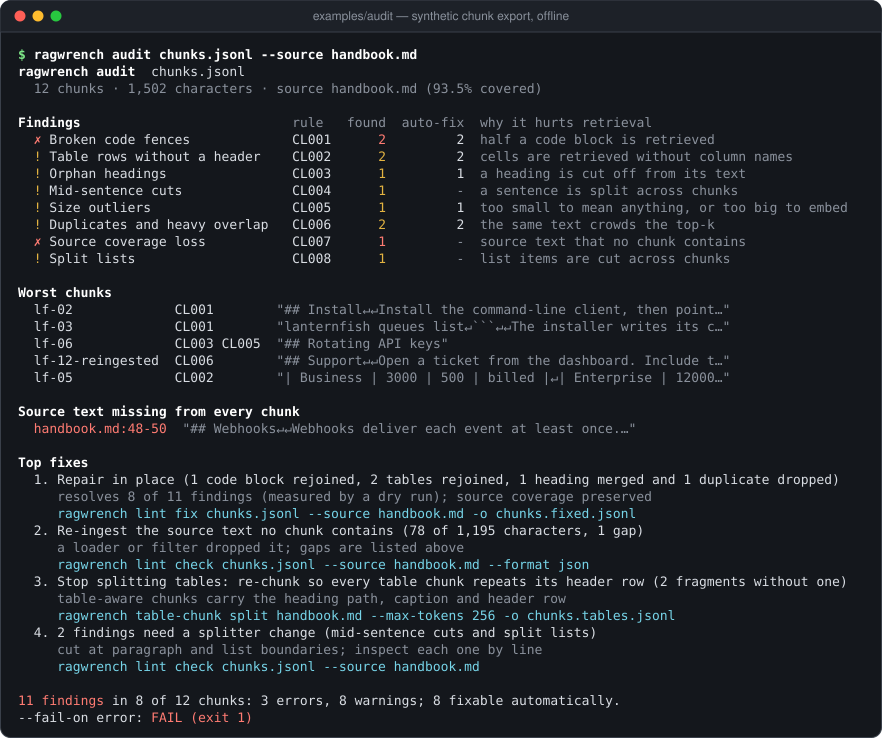

<p align="center">
  <picture>
    <source media="(prefers-color-scheme: dark)" srcset="assets/logo-dark.svg">
    
  </picture>
</p>

<p align="center">
  <strong>找出悄悄拖垮 RAG 回答的那些 chunk，然后修好它们。</strong><br>
  一个离线命令行工具：chunk 质检、向量库搬运、引用核查、检索评测。
</p>

<p align="center">
  <a href="https://github.com/tianhaogutum/ragwrench/actions/workflows/ci.yml"></a>
  <a href="https://pypi.org/project/ragwrench/"></a>
  <a href="https://pypi.org/project/ragwrench/"></a>
  <a href="LICENSE"></a>
</p>

<p align="center">
  <a href="README.md">English</a> · 简体中文
</p>

<p align="center">
  <strong>按固定 token 数切表格，BM25 只能为 15% 的查询找回正确的单元格；每个 chunk 都带上表头，就是 100%。</strong><br>
  <sub>4 张 60 行的合成表格、720 次单元格查询、同样 120 token 的预算，hit@3 为 0.154 对 1.000。<a href="benchmarks/table-chunk/results.json">存档结果</a> · <a href="docs/table-chunk.md#reproduce-the-retrieval-experiment">方法</a> · 用 <code>ragwrench table-chunk bench</code> 复现。</sub>
</p>

```sh
uvx ragwrench audit chunks.jsonl --source handbook.md   # 或：pipx install ragwrench  /  pip install ragwrench
```

<p align="center">
  
</p>
<p align="center"><sub>仓库自带合成示例（<code>examples/audit</code>，内容虚构，不联网）上的真实输出。用 <code>assets/render_terminal.py</code> 重新生成。</sub></p>

## 快速上手

`audit` 读取一份 chunk 导出文件（JSONL 或 JSON 数组；LangChain 的 `page_content`、LlamaIndex 节点、或者最简单的 `{"id", "text"}` 都行），全程只读，不写任何文件：

```sh
uvx ragwrench audit chunks.jsonl                        # 只查结构
uvx ragwrench audit chunks.jsonl --source handbook.md   # 再查一遍：源文档的每段话是否都进了某个 chunk
uvx ragwrench audit exports/ --fail-on warning          # 整个目录一起查，当作 CI 关卡
```

不用注册，不用 API key，不用模型。想先跑一下上面的演示：

```sh
git clone https://github.com/tianhaogutum/ragwrench && cd ragwrench/examples/audit
uvx ragwrench audit chunks.jsonl --source handbook.md
```

退出码：`0` 表示没有达到 `--fail-on` 级别（默认 `error`）的问题，`1` 表示有，`2` 表示用法或输入错误。`--format json` 输出 `ragwrench.audit/v1` 文档，`--format sarif` 输出 SARIF 2.1.0（每个文件一个 run）。

## `audit` 查什么

| 类别 | 规则 | 为什么会伤害检索 | 怎么修 |
| --- | --- | --- | --- |
| 代码块被切断 | CL001 | 只检索到半段代码，chunk 剩下的部分也被当成代码渲染 | `lint fix` |
| 表格行没有表头 | CL002 | 单元格被检索出来时没有列名 | `lint fix`、`table-chunk` |
| 孤立标题 | CL003 | 标题在一个 chunk 里，正文在下一个 | `lint fix` |
| 句子被截断 | CL004 | 一句话被拆到两个 chunk 里 | 调整切分器 |
| 大小异常 | CL005 | 太小撑不起语义，或太大不适合做向量 | `lint fix`（过大的） |
| 重复与过度重叠 | CL006 | 同样的内容挤占 top-k 里其他结果的位置 | `lint fix`（完全重复的） |
| 源文本丢失 | CL007 | 源文档里有、但没有任何 chunk 包含的文字（需 `--source`） | 重新导入 |
| 列表被拆开 | CL008 | 列表项被切到不同 chunk | 调整切分器 |

规则来自 [`ragwrench lint`](docs/lint.md)。报告里的 “auto-fix” 一列不是估算：`audit` 会在内存里真跑一遍 `lint fix`，再数剩下多少问题。修复建议按效果排序，并给出可以直接复制的命令，比如 `ragwrench lint fix chunks.jsonl --source handbook.md -o chunks.fixed.jsonl`。`lint fix` 只做保守的修改（把切断的代码块或表格接回去、把孤立标题并入下一个 chunk、删掉完全重复的 chunk、在结构边界拆开过大的 chunk），会校验没有丢失任何非空白字符、源文档覆盖率没有下降，并在输出旁边写一份变更日志。

## 全部命令

| | 命令 | 作用 | 文档 |
| --- | --- | --- | --- |
| **切分（Chunking）** | `audit` | 对一份 chunk 导出做只读体检，每个问题都附上修复命令 | [audit](docs/audit.md) |
| | `lint` | 对照源文档检查 chunk；保守修复、可保存的修复计划、SARIF | [lint](docs/lint.md) |
| | `table-chunk` | 把 Markdown/HTML 切成理解表格的 chunk，每块都带标题路径和表头 | [table-chunk](docs/table-chunk.md) |
| **索引与向量库** | `sync` | 为本地 Qdrant 规划、审阅并执行增量 chunk 更新 | [sync](docs/sync.md) |
| | `bm25` | 支持中日韩文本的 BM25 稀疏向量，在 Qdrant 本地模式下检索 | [bm25](docs/bm25.md) |
| | `migrate` | Chroma ↔ Qdrant 迁移，保留原向量并校验一致性 | [migrate](docs/migrate.md) |
| **回答与评测** | `cite-check` | 对照来源检查 Dify、RAGFlow、LlamaIndex 或 JSONL 回答里的引用 | [cite-check](docs/cite-check.md) |
| | `eval` | 给 TREC/JSONL 检索结果打分，用配对显著性检验拦住效果回退 | [eval](docs/eval.md) |
| **引用与 PDF** | `highlight` | 把 Docling/Unstructured 的位置信息变成 PDF 高亮和 `#page=` 引用链接 | [highlight](docs/highlight.md) |
| **平台** | `port` | 在 Dify 与 RAGFlow 之间导出导入知识库，全程哈希校验 | [port](docs/port.md) |
| | `dify-bridge` | 把 Qdrant 或 JSONL 作为 Dify 外部知识库 API 提供出去，并能检测这类接口 | [dify-bridge](docs/dify-bridge.md) |

`ragwrench <命令> --help` 会列出所有子命令和选项。每个命令在 `examples/<命令>/` 下都有能直接跑的例子。

## 分组示例

### 切分

```sh
ragwrench lint check chunks.jsonl --source doc.md --format sarif > lint.sarif
ragwrench lint fix chunks.jsonl --source doc.md -o fixed.jsonl          # 同时写出 fixed.jsonl.changes.json
ragwrench table-chunk split report.md --max-tokens 256 -o chunks.jsonl  # 也支持 .html
```

### 索引与向量库（`pip install 'ragwrench[qdrant]'`，`migrate` 需要 `[chroma]`）

```sh
ragwrench sync snapshot --dir docs_v2 -o new.json
ragwrench sync plan old.json new.json -o plan.json        # 有待审阅的变更时退出码为 10
ragwrench sync apply plan.json --qdrant-path .qdrant --collection kb
ragwrench bm25 index --path .qdrant --collection kb corpus_zh.jsonl --tokenizer cjk-bigram
ragwrench migrate copy 'chroma:./chroma#docs' 'qdrant:./qdrant#docs' --dry-run
```

### 回答与评测

```sh
ragwrench cite-check check --format dify response.json
ragwrench eval compare --qrels qrels.tsv --baseline base.trec --candidate cand.trec \
  --metrics ndcg@10,recall@100 --test randomization --seed 42 --max-drop ndcg@10=0.01
```

### 引用与 PDF

```sh
ragwrench highlight normalize --format docling doc.docling.json --pdf doc.pdf -o regions.jsonl
ragwrench highlight annotate doc.pdf regions.jsonl -o highlighted.pdf
```

### 平台

```sh
ragwrench port export dify --base-url http://localhost/v1 --dataset-id <id> -o ./bundle
ragwrench port import ragflow ./bundle --base-url http://localhost:9380 --dataset-name handbook --state kb.json --dry-run
ragwrench dify-bridge serve --config bridge.toml --port 8765
```

## 可选依赖

| 安装方式 | 增加的功能 |
| --- | --- |
| `pip install ragwrench` | `audit`、`lint`、`table-chunk`、`cite-check`、`eval`、`highlight`、`port`、`dify-bridge`（JSONL 后端） |
| `pip install 'ragwrench[qdrant]'` | `sync`、`bm25`，以及 `dify-bridge` 的 Qdrant 后端 |
| `pip install 'ragwrench[chroma]'` | `migrate`（chromadb 暂不支持 Python 3.14） |
| `pip install 'ragwrench[all]'` | 以上全部，外加 `bm25 --tokenizer jieba` 用的 `jieba` |

用 `uvx` 的写法：`uvx --from 'ragwrench[qdrant]' ragwrench sync --help`。

## 和现有工具的关系

ragwrench 位于切分器和索引之间、检索器和用户之间。它不替你切文档（表格除外），也不替代基于大模型打分的评测。

| 你在用 | 它负责 | ragwrench 补上的部分 |
| --- | --- | --- |
| LangChain / LlamaIndex 的切分器、Chonkie | 生成 chunk | 检查生成的结果：被切断的代码块和表格、孤立标题、重复、丢失的源文本，并安全修复。与切分器无关，只读导出的 JSONL。 |
| Unstructured、Docling | 解析文档并记录位置 | `highlight` 把这些位置信息变成 PDF 高亮和引用链接。 |
| ragas、DeepEval、TruLens | 用大模型评判回答质量（忠实度、相关性） | 确定性、不依赖模型的检查：chunk 结构（`audit`、`lint`）和引用标记与来源是否对得上（`cite-check`）。成本低到每次提交都能跑；是互补，不是替代。 |
| trec_eval、ranx、ir_measures | 计算检索指标（ranx 也提供显著性检验） | 把 `eval compare` 当作 CI 关卡：按指标设置 `--max-drop` 阈值、配对随机化或 bootstrap 检验、JUnit 输出。nDCG 和 MAP 采用 trec_eval 的定义。 |
| 向量库 SDK 和临时脚本 | 写入、复制向量 | 写入前可审阅的差异（`sync`）、带一致性校验的迁移（`migrate`）、支持中日韩的 BM25（`bm25`）。 |

## 可信度与边界

- **默认离线，不收集任何数据。** 只有在你配置了地址时才会联网：`port`（Dify 和 RAGFlow 的 API）和 `dify-bridge`（它自己的服务、`check`，以及可选的 HTTP 向量服务或 Qdrant 服务器）。`table-chunk` 的可选 tiktoken 计数器首次使用时可能会下载词表。
- **除非你指定输出，否则只读。** `audit` 和 `lint check` 不改任何东西。会写文件的命令都要求显式给出输出路径；`lint fix` 拒绝覆盖输入、源文档或配置文件，并以原子方式写入。
- **启发式规则会标明。** 句子截断和列表拆分是边界启发式规则，源文档对齐基于规范化后的文本。上面的表格基准是合成数据，只用来隔离“表头丢失”这一个因素，不代表在你的语料上的准确率。
- **测试。** 1,700 多个测试函数；CI 覆盖 Linux 上的 Python 3.11 到 3.14，以及 macOS 上的 Python 3.13。
- **平台。** Linux 和 macOS，Python 3.11+。Windows 未测试。

ragwrench 是独立项目，与 Dify、RAGFlow、LangChain、LlamaIndex、Qdrant、Chroma、Docling、Unstructured 均无关联。第三方声明见 [THIRD_PARTY.md](THIRD_PARTY.md)。

## 许可证

MIT，见 [LICENSE](LICENSE)。

---

<p align="center">如果 ragwrench 帮你揪出了一个悄悄拖垮回答的 chunk，点个 star 能让更多人找到它。</p>
